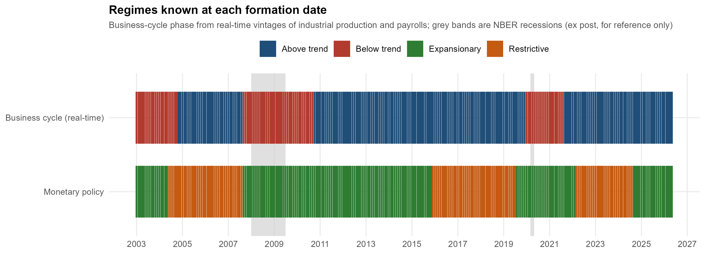
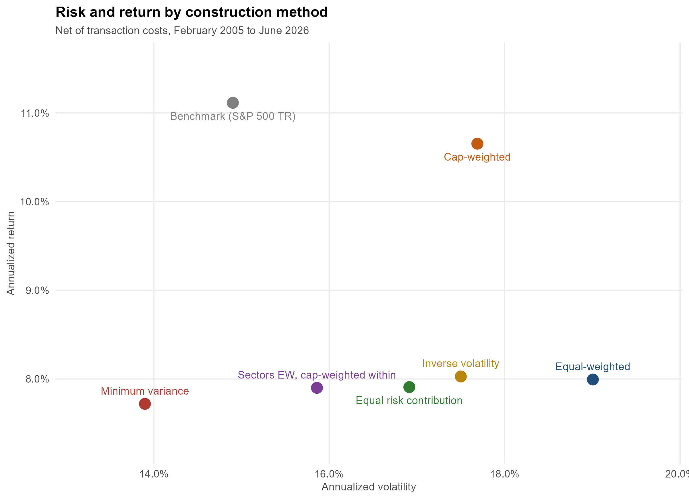

# Market regimes, sector rotation and portfolio construction in the S&P 500

A point-in-time backtesting study on the **historical constituents of the S&P 500 (2005–2026)**, written in R.

The project asks two questions:
- can **market-regime signals** (statistical, business-cycle and monetary-policy) guide **sector rotation**?
- holding the selected stocks fixed, how much does the **portfolio construction method** change return and risk?

**Paper:** [Market Regimes, Sector Rotation and Portfolio Construction in the S&P 500, 2005–2026](Regimes_Sector_Rotation_SP500.pdf)

> **Data are not included.** Market data come from LSEG under a university licence and cannot be redistributed; public data are downloaded by the scripts. See [Data](#data).

## Highlights

- **Survivorship-free universe.** Index membership is rebuilt month by month from LSEG joiner/leaver events. Securities are identified by a stable key (PermID + share class), never by ticker. Delisting returns come from documentary research on corporate exits.
- **No look-ahead bias, by construction.**
  - Information up to the end of month *t* forms the portfolio; the return is earned in *t*+1, with joins made on the calendar, never by row position.
  - Macro regimes use the **data vintages available at each date** (Philadelphia Fed Real-Time Data Set), not revised data.
  - The hidden Markov model is re-estimated every month on an expanding window and uses filtered probabilities only.
- **Sectors chosen by the data, not by the literature.** At each date, the expected return of each sector in each regime is estimated from past returns only, weighted by the regime *as it was known* at each past date.
- **Honest evaluation.**
  - Every strategy is compared on the same 257 months, gross and net of costs (10 bp per side), with Newey-West inference.
  - The regime definitions had to pass acceptance criteria fixed in advance, evaluated on the regimes alone, before any strategy return was computed.
  - Every methodological decision is logged with its motivation and evidence, including the ones taken after a check failed.

## Results

### 1. Market regimes and sector rotation

**Rotation rule.** At each date, the strategy holds the 3 sectors (out of 10 TRBC economic sectors) with the highest expected return in the current regime.

**Benchmark for the regime.** The same rule without any regime (the *unconditional rotation*). The difference between the two isolates the value of the regime.

| Regime signal | Annual return (net) | Difference vs unconditional | t-stat |
|---|---|---|---|
| None (unconditional rotation) | 9.02% | — | — |
| Hidden Markov model on market returns | 8.85% | −0.19% | −0.30 |
| Real-time business cycle (Philadelphia Fed vintages) | 8.20% | −0.93% | −0.91 |
| Monetary policy (last FOMC move) | 8.99% | −0.15% | −0.10 |
| *S&P 500 Total Return* | *11.11%* | | |

None of the three regime definitions improves sector rotation. The reason differs by signal:
- **The HMM** identifies *volatility* regimes, not economic ones.
- **The business-cycle regime** does separate market conditions: after a below-trend month the market returned 6.7% a year with 22% volatility, against 13.4% and 13% after an above-trend month. But sector prices move *ahead* of the real-time macro data.



### 2. Construction methods with a fixed signal

The same stocks (those selected by the business-cycle rotation) are weighted by six methods:

| Method | Annual return | Volatility | Sharpe | Max drawdown | Effective no. of stocks |
|---|---|---|---|---|---|
| Equal-weighted | 7.99% | 19.0% | 0.41 | −57.5% | 135 |
| Cap-weighted | 10.65% | 17.7% | 0.57 | −51.6% | 25 |
| Inverse volatility | 8.03% | 17.5% | 0.44 | −54.2% | 124 |
| Equal risk contribution | 7.91% | 16.9% | 0.44 | −52.0% | 111 |
| Minimum variance (Ledoit-Wolf) | 7.72% | 13.9% | 0.49 | −47.1% | 16 |

**Construction changes risk, not return.**
- **Return**: no method's return differs significantly from equal-weighting.
- **Risk**: every method has significantly lower volatility (Pitman-Morgan test, *p* < 0.01).
- **Minimum variance** cuts volatility by a quarter, at the cost of concentration and the highest turnover. Its ex-ante risk is underestimated: 8.9% predicted against 13.9% realised.



## Repository structure

```
R/                                   generic modules and data pipeline
  00_universo.R                      builds universe and dataset: point-in-time membership,
                                     security key, monthly panel, delisting returns,
                                     benchmark and factors
  01_dati_pit.R                      point-in-time data: membership, crosswalk, panel, LSEG adapters
  02_segnali_backtest.R              timeline, look-ahead test, delisting rules, backtest engine
  04_valutazione.R                   factors, benchmark, metrics, Newey-West regressions

dati/                                local data, not in the repository (LSEG licence)

studi/                               regimes, sector rotation and construction
  RegimeSettori.R                    study 1: hidden Markov model regimes
  RotazioneCiclo.R                   study 2: business-cycle and monetary-policy regimes
  CostruzioneCiclo.R                 study 3: construction methods on a fixed signal
  tabelle_*/  grafici_*/             tables and figures of each study
  LEGGIMI.md                         how to run the scripts (Italian)
  REGISTRO_DECISIONI.md              decision log, with motivation and evidence (Italian)
  RESULTS_SUMMARY.md                 detailed summary of results

paper/                               LaTeX source of the paper
  regimes_sector_rotation_sp500.tex         text
  tabelle_paper.R                    builds the LaTeX tables from the CSV outputs
  tab/                               generated tables
Regimes_Sector_Rotation_SP500.pdf   compiled paper
```

Code and comments are in Italian; tables, figures and this page are in English.

## Data

| Data | Source | In this repository |
|---|---|---|
| Index constituents, joiner/leaver events, monthly total returns, prices and market capitalisation, security identifiers, sector classification, S&P 500 Total Return | LSEG Workspace (university licence) | **No.** Not redistributable. |
| Delisting consideration (cash and share terms of corporate exits) | Author's documentary research, combined with LSEG prices | **No.** |
| Risk-free rate and Fama-French factors; US market returns since 1926 | Kenneth R. French Data Library | No. Downloaded by the script. |
| Real-time vintages of industrial production and payrolls | Philadelphia Fed, Real-Time Data Set for Macroeconomists | No. Downloaded by the script. |
| FOMC federal funds target decisions | Federal Reserve Board | No. Downloaded by the script. |

Reproducing the study requires LSEG Workspace access and the credential in the `LSEG_APP_KEY` environment variable, never in the code. Place the two LSEG exports of the index (`SPX Current Constituents.xlsx` and `SPX Leavers & Joiners Constituents.xlsx`) in `dati/`. `R/00_universo.R` then extracts and freezes everything else on the first run: membership, security key, monthly series and benchmark.

## Running

Requires R 4.x with `dplyr`, `tidyr`, `lubridate`, `readxl`, `writexl`, `ggplot2`, `scales` and `quadprog`; `Refinitiv` for the LSEG extraction; `rvest` and `xml2` for the FOMC decisions.

1. Open `studi/studi.Rproj` and run any of the three scripts. Each one runs the data pipeline in `R/00_universo.R` and the earlier steps it depends on.
2. **Paper**: from `paper/`, run `Rscript tabelle_paper.R`, then compile `regimes_sector_rotation_sp500.tex` twice with `pdflatex`.

## License

The code is released under the [MIT License](LICENSE). The licence does not cover the market data, which are not part of the repository and remain subject to the terms of their providers.
